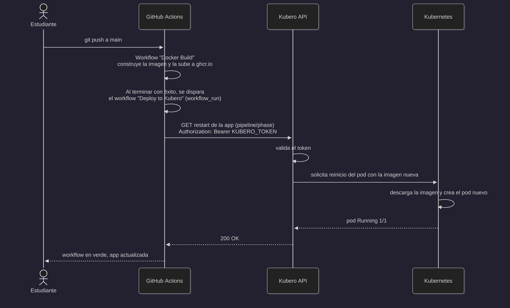
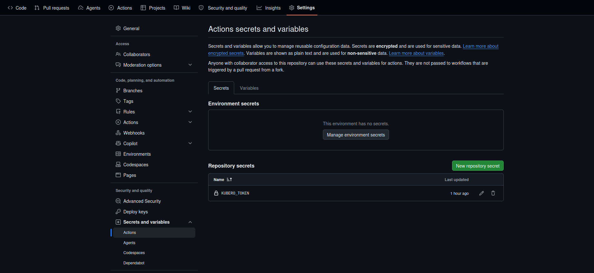
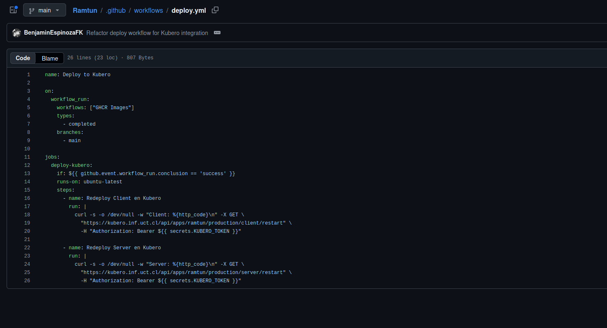
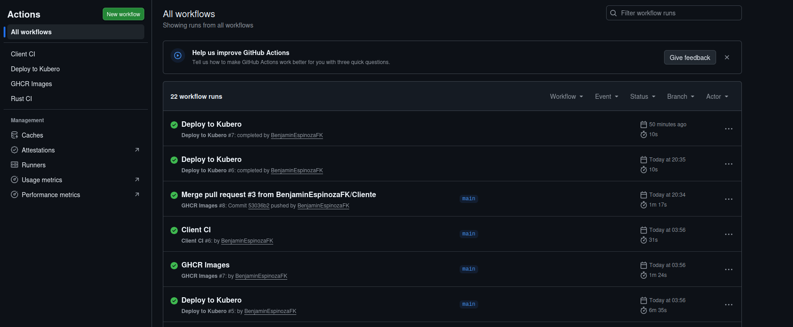
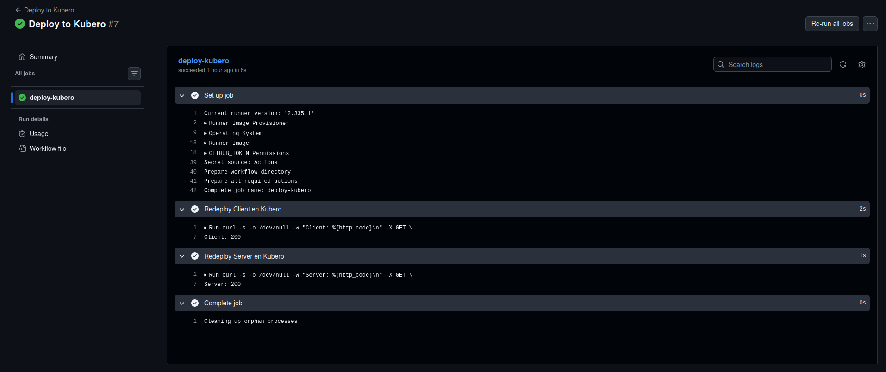

# Autodeploy: Redespliegue Automático

El **autodeploy** permite que cada vez que un estudiante hace `git push` a su repositorio, Kubero redespliega la aplicación automáticamente con la nueva imagen — sin que nadie tenga que hacer nada manualmente.

El flujo completo es:



En resumen: `git push` → GitHub Actions construye la imagen → llama al API de Kubero → Kubero redespliega ✓

---

## ¿Qué hace el estudiante? (una sola vez por proyecto)

Cada estudiante genera su propio token de autorización para el API de Kubero, desde su propia cuenta — nunca se comparte entre compañeros ni grupos.

### Paso 1 — Generar el token de autorización

1. Accede a [Kubero UCT](https://kubero.inf.uct.cl) con tu propia cuenta.
2. Abre el menú del avatar → **Perfil** (**Profile**).
3. En **Tokens de API** (**API Tokens**), pulsa **Crear token** (**Create Token**).
4. Completa los campos:

   | Campo          | Valor                                                                       |
   | -------------- | --------------------------------------------------------------------------- |
   | **Name**       | `autodeploy-github`                                                         |
   | **Expires At** | Fecha y hora futuras, acordadas con el profesor para la duración del curso. |

5. Haz clic en **"CREATE"**.
6. **Copia el token inmediatamente.** Solo se muestra una vez y no se puede recuperar después.

> Si el token vence o se pierde, genera uno nuevo desde el perfil y actualiza el secret `KUBERO_TOKEN` en el repositorio.

### Paso 2 — Agregar el token como secret en GitHub

1. Ve a tu repositorio en GitHub
2. Haz clic en **"Settings"** → **"Secrets and variables"** → **"Actions"**
3. Haz clic en **"New repository secret"**
4. Completa:

   | Campo      | Valor                                    |
   | ---------- | ---------------------------------------- |
   | **Name**   | `KUBERO_TOKEN`                           |
   | **Secret** | Pega el token que generaste en el Paso 1 |

5. Haz clic en **"Add secret"**



> Al hacer clic en **"New repository secret"**, aparecerá un formulario con dos campos: **Name** (escribe `KUBERO_TOKEN`) y **Secret** (pega el token generado en el Paso 1). Luego haz clic en **"Add secret"** y el secret quedará visible en la lista con el nombre `KUBERO_TOKEN`.

### Paso 3 — Agregar el workflow de redepliegue

En tu repositorio, crea el archivo `.github/workflows/deploy.yml` con el siguiente contenido.

Reemplaza los valores marcados con los de tu proyecto en Kubero:

```yaml
name: Deploy to Kubero

on:
  workflow_run:
    workflows: ["Docker Build"] # Cambia esto por el nombre exacto de tu workflow de build
    types:
      - completed
    branches:
      - main

jobs:
  deploy-kubero:
    if: ${{ github.event.workflow_run.conclusion == 'success' }}
    runs-on: ubuntu-latest
    steps:
      - name: Redeploy en Kubero
        run: |
          curl -s -o /dev/null -w "%{http_code}\n" -X GET \
            "https://kubero.inf.uct.cl/api/apps/NOMBRE-PIPELINE/production/NOMBRE-APP/restart" \
            -H "Authorization: Bearer ${{ secrets.KUBERO_TOKEN }}"
```

> - `"Docker Build"` → el nombre exacto del workflow que construye tu imagen (revisa la pestaña Actions de tu repo para ver el nombre)
> - `NOMBRE-PIPELINE` → el nombre del pipeline en Kubero (ej: `mi-proyecto`)
> - `NOMBRE-APP` → el nombre de la app dentro del pipeline (ej: `frontend` o `backend`)
> - Si tienes frontend y backend, agrega un paso adicional por cada uno



### Paso 4 — Verificar que funciona

1. Haz cualquier cambio en tu código y haz `git push` a `main`
2. Ve a la pestaña **"Actions"** de tu repositorio en GitHub
3. Primero se ejecuta el workflow de build (construye la imagen)
4. Al terminar, se activa automáticamente el workflow **"Deploy to Kubero"**
5. El paso debe mostrar `200` como resultado — eso confirma que Kubero recibió el redepliegue
6. Revisa la aplicación en Kubero y sus registros.





| Código de respuesta | Significado                                                                                |
| ------------------- | ------------------------------------------------------------------------------------------ |
| `200`               | Solicitud de reinicio aceptada; verifica después el estado de la app.                      |
| `401`               | Token inválido, vencido o revocado, o cuenta desactivada. Revisa tu propio token y cuenta. |
| `403`               | Permisos insuficientes, acceso al equipo del pipeline o modo de solo lectura.              |
| `404`               | El nombre del pipeline o app no coincide con Kubero — verifica los nombres                 |
