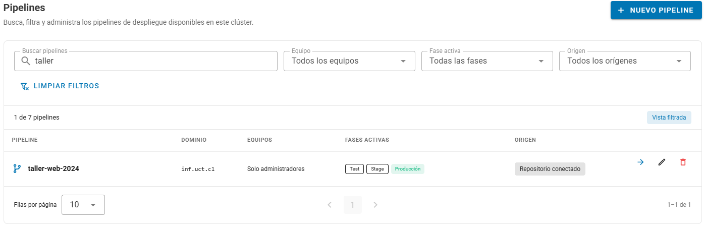
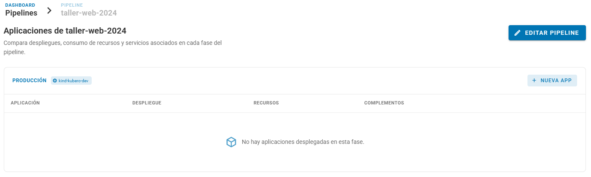
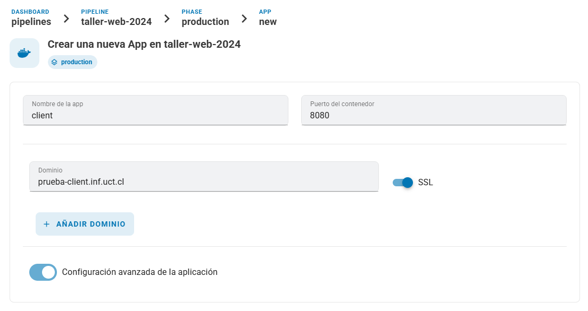
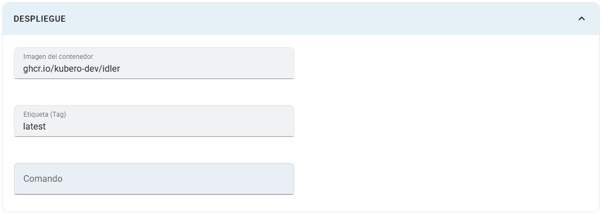
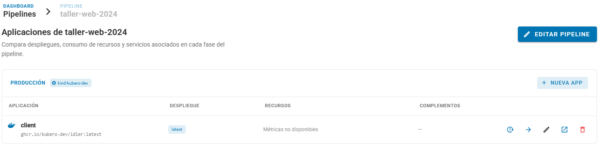

# Crear Pipeline y App

Prepara la imagen siguiendo [Primeros pasos](primeros-pasos.md) y confirma que perteneces al equipo del proyecto.

## Crear un Pipeline

Un **pipeline** agrupa las aplicaciones de un proyecto y establece qué equipos tienen acceso.

### Pasos

1. En **Pipelines**, haz clic en **Nuevo pipeline**.

2. Completa los campos:

| Campo | Qué ingresar |
|---|---|
| **Nombre** | Identificador del proyecto, por ejemplo `taller-web-2024`. |
| **Acceso de equipo** | El equipo de tu grupo o trabajo individual creado por el profesor. |
| **Dominio (FQDN)** | Dominio base habilitado para el curso, cuando corresponda. |
| **Fases** | Activa **Production** y selecciona el contexto de clúster ofrecido para esa fase. |

::: warning Importante
Selecciona al menos el equipo del proyecto. El equipo debe existir y tener sus miembros asignados; escribir un nombre no incorpora personas automáticamente. La captura muestra la disposición del formulario antes de completar todos los campos.
:::

3. Haz clic en **Crear pipeline**.
4. Busca el pipeline creado y ábrelo.

## Crear una App y hacer tu primer despliegue

### Paso 1 — Agregar una App al Pipeline

Dentro del pipeline, pulsa **Nueva app** en la fase `production`. Configura frontend y backend como aplicaciones independientes.

### Paso 2 — Configurar la App

| Campo | Descripción | Ejemplo |
|---|---|---|
| **Nombre de la app** | Identificador del servicio; usa un nombre sencillo en minúsculas. | `frontend` |
| **Puerto del contenedor** | Puerto real del proceso dentro de la imagen. | `80` para Nginx; `3000` para un backend que escucha allí. |
| **Dominio** | Subdominio donde estará accesible tu app | `mi-app.inf.uct.cl` |
| **SSL** | Actívalo para configurar HTTPS en ese dominio. | Activado para una app pública del curso. |

> **Sobre el dominio:** Debe ser único en la plataforma. Si `mi-app.inf.uct.cl` ya está en uso, elige algo diferente como `taller2024.inf.uct.cl`. Cualquier subdominio de `*.inf.uct.cl` es válido.

**Añadir dominio** incorpora otros hosts a la misma app. Para un servicio interno, deja los dominios vacíos y consulta [Base de datos y variables](base-de-datos.md#app-interna-sin-exposicion-publica-imagen-custom).

En **Despliegue**, completa directamente la imagen y la etiqueta.

| Campo | Valor de ejemplo |
|---|---|
| **Imagen del contenedor** | `ghcr.io/tu-usuario/nombre-imagen`, sin la etiqueta. |
| **Etiqueta (Tag)** | `latest` o la versión que publicaste. |

> El nombre exacto de la imagen lo encuentras en `https://github.com/TU-USUARIO?tab=packages`. Copia el nombre tal como aparece.

El **Comando** aparece al tener la configuración avanzada activada; conserva el comando original de la imagen si no necesitas reemplazarlo.

### Paso 3 — Guardar y esperar

1. Pulsa **Crear app** al crearla o **Actualizar** al editarla.
2. Vuelve a la tabla del pipeline. Mientras se prepara el despliegue puede mostrar **Métricas no disponibles**.
3. En 1-2 minutos aparecerá el nombre del pod junto con valores de **CPU** y **Memory** eso indica que la app está corriendo correctamente. Si faltan datos, revisa también **Resumen**, **Registros** y **Eventos** dentro de la app: una métrica ausente no demuestra por sí sola que la app esté detenida.

El tiempo de inicio depende de la imagen, sus recursos y el clúster. Si no arranca, consulta [Errores comunes](routing-y-monitoreo.md#errores-comunes-y-como-resolverlos).

### Paso 4 — Acceder a tu App

Tu app está disponible en la URL con el dominio configurado. Por ejemplo:

~~~text
https://mi-app.inf.uct.cl
~~~

Comprueba que responde y que el puerto coincide con el de la imagen.

## Configuración adicional

Activa **Configuración avanzada de la aplicación** cuando necesites sus controles adicionales. Cada tema tiene una guía en **Extras**:

- [Autenticación básica](extras/autenticacion-basica.md) y [Seguridad](extras/seguridad.md).
- [Redes](extras/redes.md), [CORS](extras/cors.md) y [Kubernetes](extras/kubernetes.md).
- [Variables de entorno](extras/variables-de-entorno.md), [Recursos](extras/recursos.md) y [Volúmenes](extras/volumenes.md).
- [Cronjobs](extras/cronjobs.md) y [Comprobaciones de estado](extras/health-checks.md).

Sigue primero el recorrido básico y configura solo las secciones necesarias para tu aplicación.
