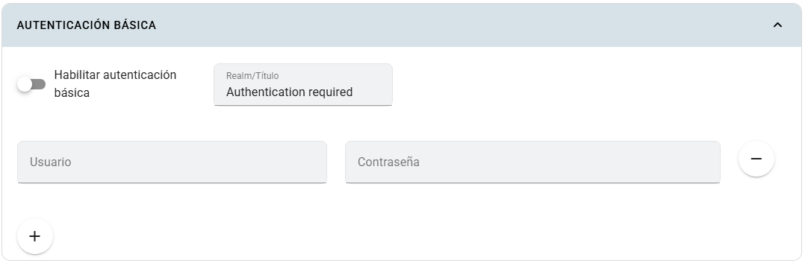

# Autenticación básica

La autenticación básica protege el acceso HTTP a una app mediante usuario y contraseña. Es independiente del inicio de sesión en Kubero y de los roles **Profesor** y **Estudiante**.

## Dónde configurarla

Abre **Crear app** o **Editar app**, activa **Configuración avanzada de la app** y despliega **Autenticación básica**.

## Campos

| Campo | Para qué sirve |
|---|---|
| Activar autenticación básica | Habilita la protección HTTP de la aplicación. |
| Realm | Nombre del espacio protegido que presenta el desafío de autenticación. |
| Usuario | Identificador de una cuenta autorizada a acceder a la app. |
| Contraseña | Contraseña de esa cuenta; no corresponde al token del API de Kubero. |
| Botones + / − | Agregan o retiran cuentas del formulario. |

## Pasos y ejemplo

1. Configura un dominio y SSL para la app.
2. Activa la autenticación y escribe un realm, por ejemplo `Proyecto del curso`.
3. Agrega una cuenta, por ejemplo `evaluacion`, y una contraseña nueva.
4. Guarda la aplicación y abre su URL en una sesión nueva del navegador.
5. Comprueba que se solicitan credenciales y que el acceso funciona con la cuenta configurada.

Mantén las contraseñas fuera del repositorio y utiliza HTTPS. Para retirar el acceso de una cuenta, elimínala de la lista y guarda la configuración.

## Limitaciones

Esta protección actúa sobre el acceso HTTP del ingress; no sustituye los permisos internos de tu aplicación ni restringe por sí sola el acceso a su servicio dentro del clúster. Requiere un dominio, ingress y controlador compatibles. Si la app ya gestiona su propia autenticación, verifica cómo conviven ambos mecanismos.

Consulta [Redes](redes.md) para el ingress y [Crear pipeline y app](../despliegue.md) para publicar el servicio.
