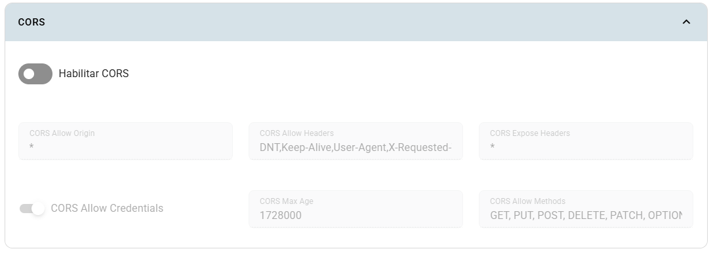

# CORS

CORS permite que el navegador de un usuario consulte un backend desde un frontend con un origen diferente. Configura este panel en la **app del backend** que recibe las solicitudes.

## Dónde configurarlo

En **Crear app** o **Editar app**, activa **Configuración avanzada de la app** y abre **CORS**.

## Campos

| Campo | Explicación |
|---|---|
| Activar CORS | Habilita las opciones; inicialmente está desactivado. |
| Orígenes permitidos | Origen del frontend: protocolo, dominio y puerto si corresponde. |
| Encabezados permitidos | Encabezados de la solicitud, separados por comas, como `Content-Type,Authorization`. |
| Encabezados expuestos | Encabezados de respuesta que el navegador puede entregar al código del frontend. |
| Permitir credenciales | Habilita solicitudes con credenciales, según la configuración del cliente. |
| Edad máxima | Tiempo, en segundos, para reutilizar el resultado de una consulta previa de CORS. |
| Métodos permitidos | Métodos HTTP separados por comas, por ejemplo `GET,POST,OPTIONS`. |

## Pasos y ejemplo

1. Activa CORS en el backend.
2. Para un frontend en `https://mi-proyecto.inf.uct.cl`, usa ese origen completo, sin ruta.
3. Permite `GET,POST,OPTIONS` y los encabezados que realmente envía tu frontend.
4. Desactiva credenciales si tu flujo no las necesita; revisa ese ajuste si usas cookies.
5. Guarda y prueba desde el navegador, incluyendo la solicitud previa `OPTIONS` cuando corresponda.

Estos campos generan anotaciones de ingress-nginx. Consulta su [documentación de CORS](https://kubernetes.github.io/ingress-nginx/user-guide/nginx-configuration/annotations/#enable-cors) para formatos y comportamiento del controlador.

## Limitaciones

CORS no autentica usuarios ni reemplaza los permisos del backend. El panel no tiene efecto si el controlador no interpreta las anotaciones. Si el backend también emite encabezados CORS, evita respuestas duplicadas o contradictorias. Una solicitud que funciona desde una terminal aún puede fallar por CORS en el navegador.

Revisa también la URL del backend en [Routing y monitoreo](../routing-y-monitoreo.md).
