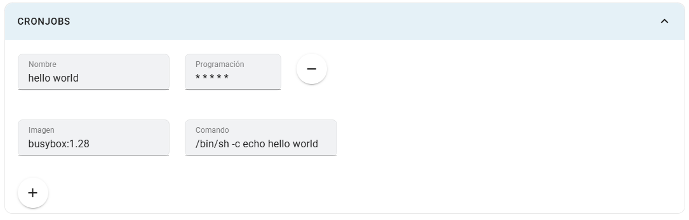

# Cronjobs

Un Cronjob ejecuta una tarea periódica en un contenedor, por ejemplo un proceso de limpieza o un cálculo programado. No necesita mantener una app web atendiendo solicitudes.

## Dónde configurarlos

En **Crear app** o **Editar app**, abre **Cronjobs** y pulsa **+**. Este panel no requiere la configuración avanzada.

## Campos

| Campo | Explicación |
|---|---|
| Nombre | Identificador de la tarea; usa un nombre único sin espacios. |
| Programación | Expresión cron de cinco campos: minuto, hora, día del mes, mes y día de la semana. |
| Imagen | Imagen y etiqueta que ejecutarán la tarea. |
| Comando | Programa y argumentos que se ejecutan dentro de esa imagen. |
| − | Retira la tarea del formulario. |

## Pasos y ejemplo

1. Agrega una tarea llamada `saludo-diario`.
2. Usa `0 3 * * *` para ejecutarla diariamente a las 03:00, según la zona horaria del controlador.
3. Selecciona una imagen que incluya el programa necesario, por ejemplo `busybox:1.36`.
4. Introduce este comando:

~~~sh
/bin/sh -c "echo tarea-del-curso"
~~~

5. Guarda y verifica los Jobs y sus registros cuando se cumpla la programación.

Las comillas dobles agrupan el argumento del shell en el campo **Comando**. Para una tarea real, usa una imagen que incluya tu script y sus dependencias. Consulta el [formato de CronJob de Kubernetes](https://kubernetes.io/docs/concepts/workloads/controllers/cron-jobs/).

## Limitaciones

El nombre aparece como solo lectura al editar una app existente. El formulario no expone zona horaria, política de concurrencia ni un botón para ejecutar inmediatamente. La tarea se guarda con política de reinicio `OnFailure`.

La validación del campo no garantiza que cualquier expresión aceptada sea válida en Kubernetes: usa cinco campos y verifica el resultado. Una tarea periódica no debe asumir que corre dentro del contenedor web ni que comparte automáticamente sus archivos; comprueba configuración y almacenamiento antes de usarla.
