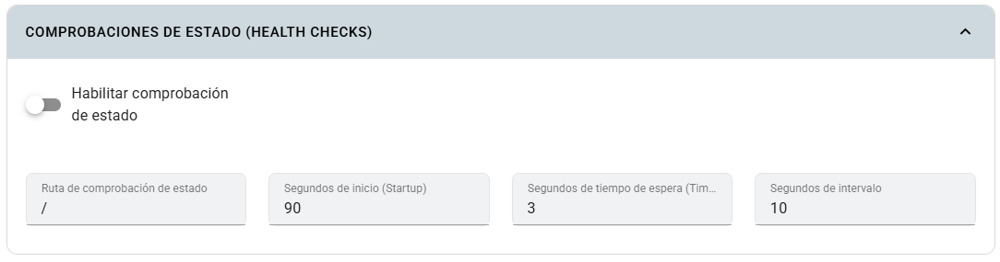

# Comprobaciones de estado

Las comprobaciones de estado permiten consultar una ruta HTTP de la app para evaluar su funcionamiento. Configúralas según el tiempo de inicio y la respuesta real del servicio.

## Dónde configurarlas

En **Crear app** o **Editar app**, activa **Configuración avanzada de la app** y abre **Comprobaciones de estado** (**Health Checks**).

## Campos

| Campo | Explicación y valor inicial |
|---|---|
| Activar comprobación | Un único interruptor; inicialmente **desactivado**. |
| Ruta HTTP | Ruta consultada, inicialmente `/`. |
| Tiempo de inicio | Margen de inicio indicado en segundos, inicialmente `90`. |
| Timeout | Tiempo de espera de la comprobación, inicialmente `3` segundos. |
| Intervalo | Periodicidad indicada en segundos, inicialmente `10`. |

## Pasos y ejemplo

1. Implementa una ruta HTTP de estado en tu app, por ejemplo `/health`.
2. Comprueba que responde correctamente en el puerto de contenedor configurado.
3. Activa la comprobación y escribe `/health`.
4. Para una app que inicia dentro de 90 segundos, comienza con inicio `90`, timeout `3` e intervalo `10`.
5. Guarda y observa **Eventos**, **Registros** y disponibilidad de los pods.

Ajusta los tiempos si el arranque requiere más margen. La comprobación debe poder responder sin un inicio de sesión interactivo.

## Limitaciones

Este formulario configura comprobaciones **HTTP**; no presenta controles separados para readiness y liveness ni un selector de comprobación TCP. El operador del clúster aplica la configuración: el formulario no permite establecer por separado todos los parámetros de las probes de Kubernetes.

No actives una ruta HTTP en PostgreSQL u otro servicio que no atienda HTTP. Un puerto incorrecto, una ruta inexistente o un timeout demasiado corto puede hacer fallar las comprobaciones aunque el proceso haya iniciado. Consulta [Routing y monitoreo](../routing-y-monitoreo.md) para diagnosticarlo.
