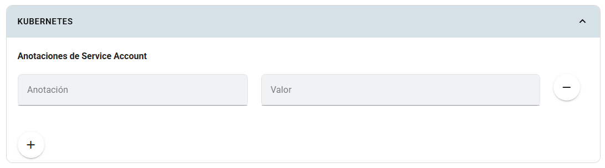

# Kubernetes

El panel **Kubernetes** permite agregar anotaciones a la Service Account de la aplicación. Una Service Account identifica procesos dentro de Kubernetes; estas anotaciones aportan metadatos para integraciones del clúster.

## Dónde configurarlo

En **Crear app** o **Editar app**, activa **Configuración avanzada de la app** y abre **Kubernetes → Anotaciones de Service Account**.

## Campos

| Control | Explicación |
|---|---|
| Anotación | Clave del metadato, con el formato que requiere la integración. |
| Valor | Valor asociado a la clave. |
| + | Agrega una fila de anotación. |
| − | Retira la fila del formulario. |

## Pasos y ejemplo

1. Confirma con el administrador si la aplicación necesita una anotación específica.
2. Pulsa **+**.
3. Introduce la clave y el valor indicados.
4. Evita claves repetidas y filas vacías.
5. Guarda la app y verifica la integración correspondiente.

Como ejemplo de metadato descriptivo, una fila podría ser:

~~~text
Anotación: cursos.inf.uct.cl/ramo
Valor: taller-integracion
~~~

Este par es ilustrativo: por sí solo no conecta servicios ni concede acceso a recursos.

## Limitaciones

El formulario actual muestra **anotaciones de Service Account**; no es un editor de manifiestos, RoleBindings o permisos de Kubernetes. Una anotación solo produce un efecto especial si existe una integración que la interprete. No introduzcas tokens, contraseñas ni claves privadas en estos campos.

Las anotaciones del **ingress** se configuran en [Redes](redes.md). El acceso de Profesor y Estudiante a los pipelines se administra mediante [Equipos](../gestion-de-equipos.md), no mediante este panel.
