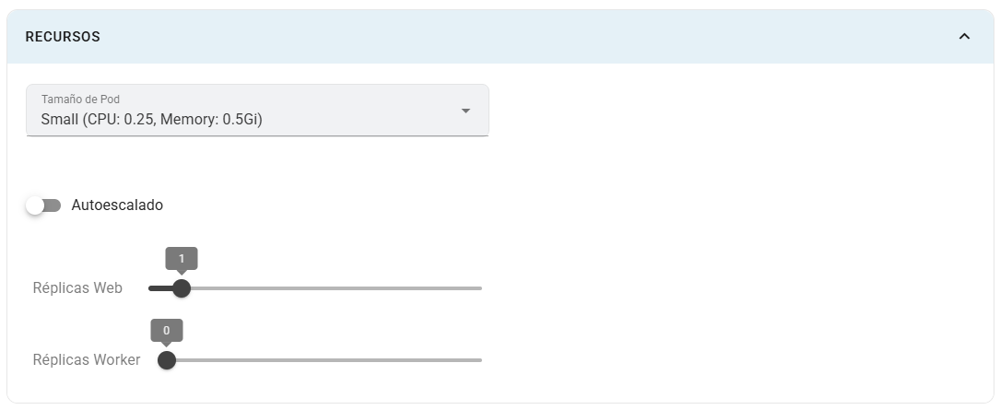

# Recursos

Este panel define el tamaño y la cantidad de pods de una app. Ajusta los recursos según el consumo observado y las opciones habilitadas en el curso.

## Dónde configurarlos

En **Crear app** o **Editar app**, abre **Recursos**. No requiere activar la configuración avanzada.

## Campos

| Campo | Explicación |
|---|---|
| Tamaño del pod | Perfil disponible con solicitudes y límites de CPU/memoria definidos por la instalación. |
| Autoescalado | Cambia el número de réplicas en función del uso de CPU/memoria y de la configuración del clúster. |
| Réplicas web | Cantidad de pods que sirven la aplicación web. |
| Réplicas worker | Cantidad de pods de trabajo en segundo plano. |
| Rangos web / worker | Mínimo y máximo de réplicas cuando el autoescalado está activo. |

La CPU y memoria se eligen mediante el **perfil de pod**; el formulario actual no ofrece campos numéricos independientes para cambiarlas.

## Pasos y ejemplo

1. Selecciona el tamaño indicado por el profesor.
2. Para una app HTTP sencilla, comienza con **1 réplica web**, **0 worker** y autoescalado desactivado.
3. Guarda y observa CPU/memoria en la tabla del pipeline y en las métricas de la app.
4. Si necesitas autoescalado y el clúster lo admite, actívalo y define, por ejemplo, un rango web **1–3**.
5. Verifica que la app puede ejecutarse en varias réplicas antes de aumentar el rango.

## Limitaciones

Los controles de réplicas y rangos permiten valores **0–10**; las cuotas y capacidad del clúster pueden imponer límites menores. Cero réplicas web deja la app sin pods web. El autoescalado depende de métricas disponibles; activarlo no garantiza un número fijo de pods.

Agregar réplicas no convierte automáticamente una app en un sistema preparado para compartir sesiones o archivos. Revisa [Volúmenes](volumenes.md) antes de escalar servicios con almacenamiento y [Routing y monitoreo](../routing-y-monitoreo.md) para observar el resultado.
