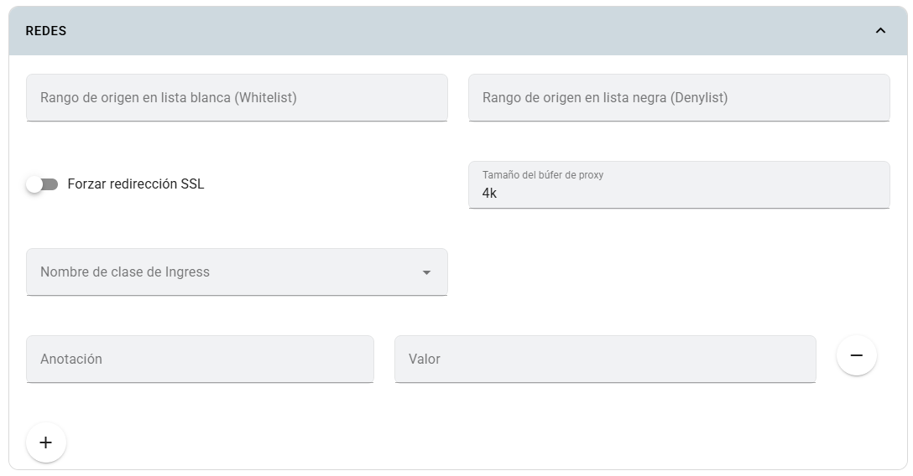

# Redes

Configura el ingress que recibe tráfico hacia la app: acceso por IP, redirección HTTPS, buffer y anotaciones adicionales.

## Dónde configurarlas

En **Crear app** o **Editar app**, activa **Configuración avanzada de la app** y abre **Redes**. Los dominios y su opción SSL se configuran en la parte inicial del formulario.

## Campos

| Campo | Explicación |
|---|---|
| Lista de acceso permitida | Rangos IP/CIDR autorizados; se guarda como `whitelist-source-range`. |
| Lista de acceso denegada | Rangos IP/CIDR que deben bloquearse; `denylist-source-range`. |
| Forzar redirección SSL | Solicita redirigir HTTP a HTTPS. El control queda deshabilitado cuando el ingress ya tiene TLS configurado. |
| Tamaño del buffer proxy | Buffer para leer encabezados de respuesta; valor inicial `4k`. |
| Clase de ingress | Controlador que procesará el recurso, entre las clases disponibles. |
| Anotación / Valor | Pares adicionales para el ingress; se agregan con **+** y retiran con **−**. |

## Pasos y ejemplo

1. Configura dominio y SSL según las indicaciones del curso.
2. Selecciona una clase de ingress disponible.
3. Si la app debe limitarse a una red, introduce su CIDR autorizado; por ejemplo `192.0.2.0/24` es un rango ilustrativo, no la red de la UCT.
4. Mantén `4k` salvo que el diagnóstico de encabezados requiera otro valor.
5. Guarda y prueba desde una dirección permitida y otra que deba bloquearse.

Las opciones específicas de Nginx requieren un controlador que reconozca sus [anotaciones](https://kubernetes.github.io/ingress-nginx/user-guide/nginx-configuration/annotations/).

## Limitaciones

El formulario rechaza claves de anotación que contengan `snippet` y las claves con formato inválido. No uses anotaciones adicionales para duplicar los campos que Kubero ya administra. El efecto depende del controlador y sus políticas; seleccionar una clase no instala ese controlador ni configura DNS.

Para conectar frontend y backend consulta [CORS](cors.md) y [Routing y monitoreo](../routing-y-monitoreo.md).
