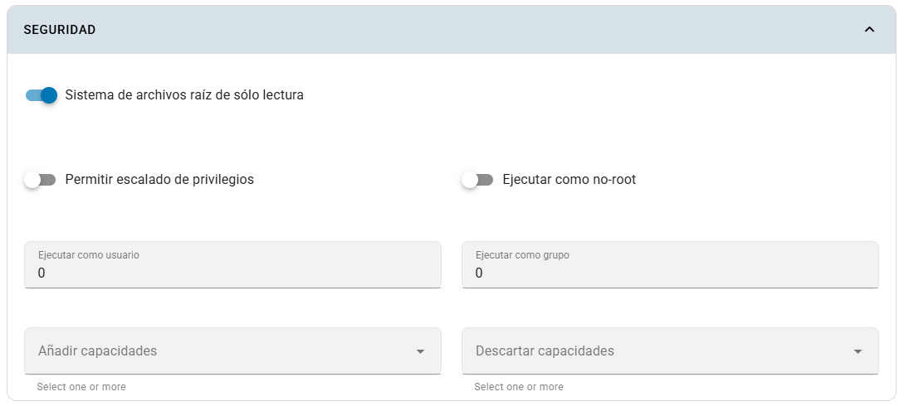

# Seguridad

Este panel configura cómo se ejecuta el contenedor: permisos de escritura, identidad y capacidades de Linux. Úsalo para ajustar una imagen a las necesidades de tu app.

## Dónde configurarla

En **Crear app** o **Editar app**, activa **Configuración avanzada de la app** y abre **Seguridad**.

## Campos

| Campo | Explicación |
|---|---|
| Sistema de archivos de solo lectura | Impide escribir en el sistema de archivos raíz del contenedor. Está activado inicialmente. |
| Permitir escalada de privilegios | Controla si un proceso puede obtener más privilegios. Está desactivado inicialmente. |
| Ejecutar como no root | Exige una identidad distinta del usuario root. |
| Ejecutar como usuario | UID numérico que ejecuta el proceso. |
| Ejecutar como grupo | GID numérico del proceso. |
| Agregar capacidades | Selección de capacidades adicionales que necesita la imagen. |
| Eliminar capacidades | Selección de capacidades que se retiran al contenedor. |

## Pasos y ejemplo

1. Revisa el usuario y las rutas de escritura que requiere tu imagen.
2. Para una imagen preparada para UID/GID `1000`, introduce esos valores y activa **Ejecutar como no root**.
3. Mantén desactivada la escalada de privilegios.
4. Si la app escribe en `/app/data`, configura un [Volumen](volumenes.md) en esa ruta.
5. Guarda y verifica el inicio en **Registros** y **Eventos**.

El UID `1000` es un ejemplo: usa la identidad admitida por tu imagen. Si aparece `Read-only file system`, identifica la ruta que necesita escritura antes de cambiar el ajuste.

## Limitaciones

Las opciones no cambian el usuario ni los permisos de archivos incluidos en la imagen. Una imagen que requiere root o escribir en rutas sin volumen puede fallar con estos ajustes. Los UID/GID aceptan números; las capacidades disponibles se eligen del listado del formulario. Las políticas del clúster también pueden rechazar una configuración.

Estos controles pertenecen al contenedor; no cambian los roles Profesor/Estudiante ni las membresías de [Equipos](../gestion-de-equipos.md).
