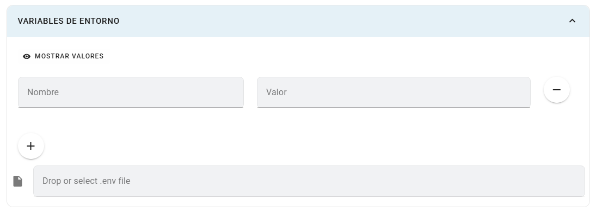

# Variables de entorno

Las variables entregan configuración al contenedor sin cambiar su imagen: direcciones de servicios, nombres de bases de datos y opciones de la aplicación.

## Dónde configurarlas

Abre **Crear app** o **Editar app** y despliega **Variables de entorno**. Este panel está disponible sin activar la configuración avanzada.

## Campos y controles

| Control | Explicación |
|---|---|
| Nombre | Nombre único de la variable. |
| Valor | Contenido que recibirá el contenedor; se oculta inicialmente. |
| Mostrar / Ocultar valores | Cambia la visibilidad de los valores en el formulario. |
| + / − | Agrega o retira una variable. |
| Archivo `.env` | Importa pares `NOMBRE=valor`; también admite archivos `.txt`. |
| Diálogo de conflictos | Permite seleccionar qué valores existentes se reemplazan. |

## Pasos y ejemplo

1. Agrega las variables que espera tu aplicación, por ejemplo:

~~~env
NODE_ENV=production
DB_HOST=server-postgres
DB_PORT=5432
DB_NAME=proyecto
~~~

2. Confirma el nombre real del servicio de base de datos; `server-postgres` es un ejemplo.
3. Para importar, selecciona o arrastra un archivo `.env`.
4. Si un nombre existe con un valor diferente, revisa el diálogo y selecciona los reemplazos que deseas aplicar. Los no seleccionados conservan su valor anterior.
5. Guarda la app y comprueba su configuración mediante registros, sin imprimir secretos.

## Limitaciones

El importador omite líneas vacías y comentarios, separa cada par en el primer `=` y retira comillas externas. No ejecuta comandos ni expande referencias a otras variables. Los valores nuevos se incorporan al formulario antes de guardar; cancelar el diálogo de conflictos no equivale a cancelar todos los cambios de la app. El formulario señala nombres duplicados.

Ocultar un valor es una ayuda visual, no un permiso adicional. No publiques archivos con credenciales. En frontends Vite, las variables `VITE_*` se sustituyen en el build y se exponen al cliente; consulta [Vite](https://vite.dev/guide/env-and-mode.html) y [Routing](../routing-y-monitoreo.md).
