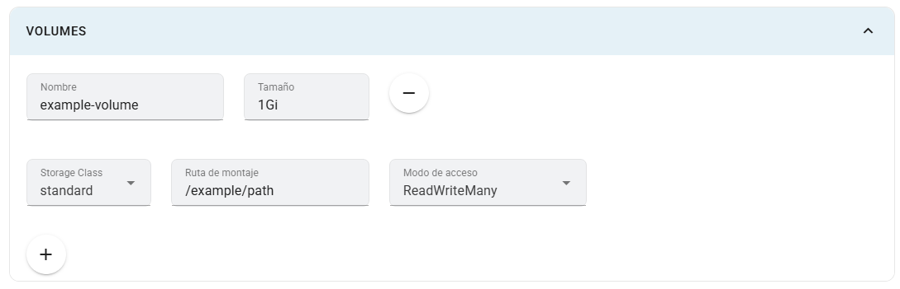

# Volúmenes

Un volumen proporciona almacenamiento montado en una ruta del contenedor. La interfaz actual permite configurar volúmenes persistentes: no es necesario tratar todas las apps internas como almacenamiento temporal.

## Dónde configurarlos

En **Crear app** o **Editar app**, abre **Volúmenes** (puede aparecer como **Volumes**). No requiere la configuración avanzada. Pulsa **+** para agregar una fila.

## Campos

| Campo | Explicación |
|---|---|
| Nombre | Identificador del volumen; usa un nombre único y sin espacios. |
| Tamaño | Capacidad solicitada, por ejemplo `1Gi`. |
| Clase de almacenamiento | Clase disponible en el clúster que aprovisiona el almacenamiento. |
| Ruta de montaje | Ruta dentro del contenedor donde la app leerá y escribirá datos. |
| Modo de acceso | `ReadWriteOnce`, `ReadWriteMany` o `ReadOnlyMany`. |

`ReadWriteOnce` permite escritura desde un nodo; no significa necesariamente un único pod. `ReadWriteMany` permite escritura desde varios nodos y `ReadOnlyMany` lectura desde varios. La clase y el proveedor deben admitir el modo elegido. Consulta [volúmenes persistentes de Kubernetes](https://kubernetes.io/docs/concepts/storage/persistent-volumes/).

## Pasos y ejemplo

1. Agrega un volumen llamado `datos-app` con tamaño `1Gi`.
2. Selecciona una clase disponible y el modo de acceso que soporte.
3. Para una app que guarda archivos en `/app/data`, usa esa ruta de montaje.
4. Guarda y verifica que el volumen se provisiona y que el contenedor puede escribir allí.
5. Comprueba la continuidad de los datos tras un redespliegue controlado.

## Limitaciones

Los valores iniciales de una fila son ejemplos; revisa especialmente clase, ruta y modo. Solo persisten los datos guardados en la ruta montada. La imagen debe admitir esa ruta y los permisos del usuario del contenedor.

Un volumen no es un respaldo. Antes de eliminar una app, confirma cómo se conservan sus volúmenes y las políticas de retención de la instalación. Para bases de datos, utiliza la ruta de datos exigida por la imagen y revisa [Base de datos y variables](../base-de-datos.md).
