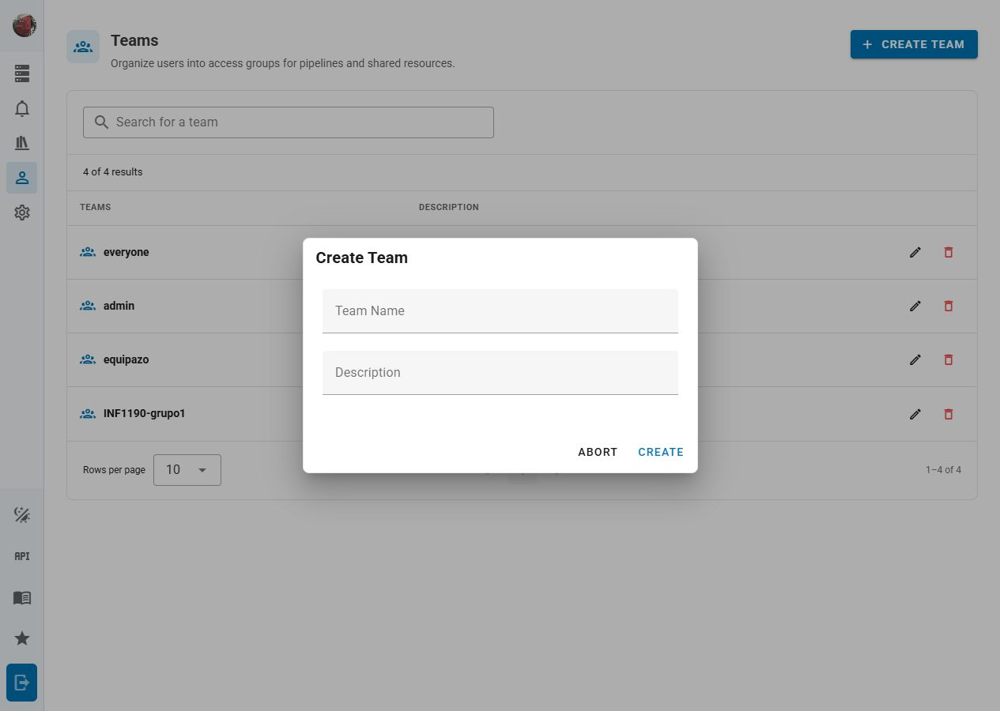
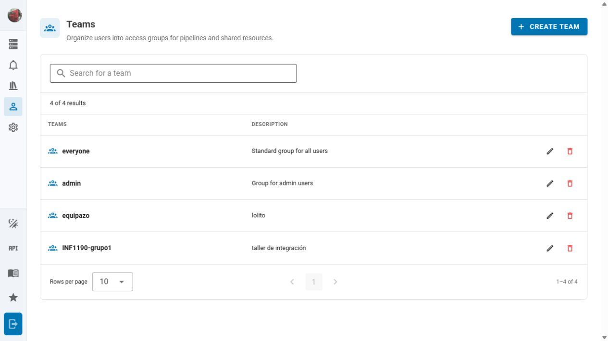
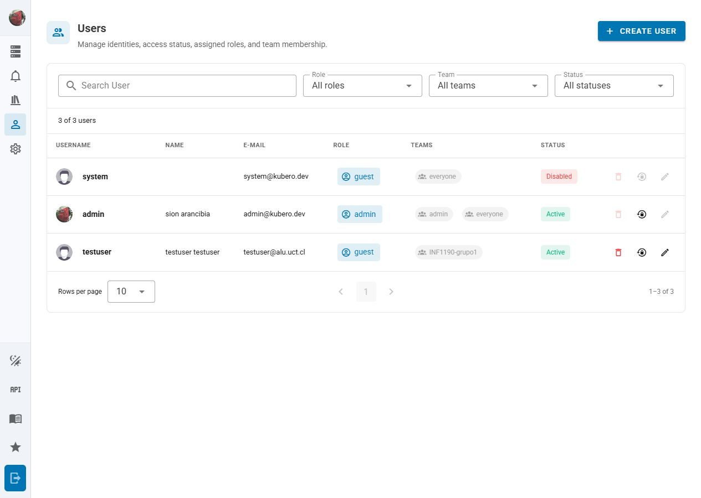
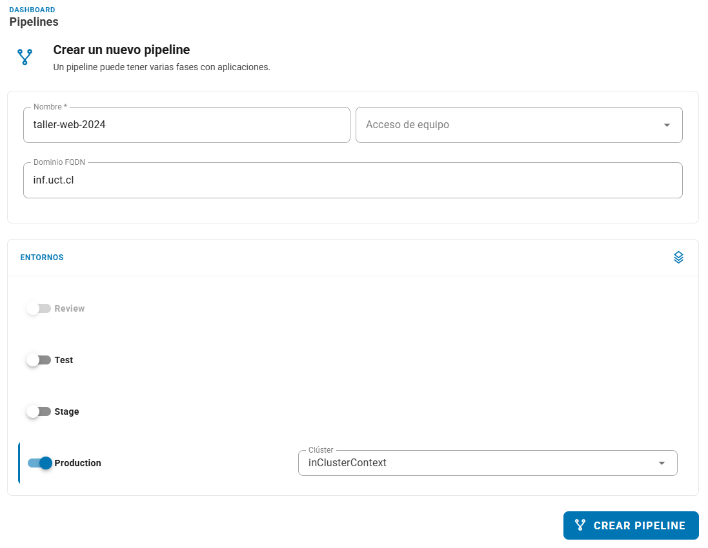

# Gestión de Equipos

Los equipos organizan el acceso a los pipelines del curso. Una cuenta puede pertenecer a varios equipos y un pipeline puede permitir acceso a varios de ellos.

## Organización y nombres

Utiliza una de estas estructuras:

| Organización | Estructura | Ejemplo |
|---|---|---|
| Trabajo grupal | `nombre del ramo - grupo_x` | `Taller de Integración - grupo_1` |
| Trabajo individual | `nombre del ramo - estudiante_x` | `Taller de Integración - estudiante_jperez` |

Mantén el mismo equipo en la membresía de las cuentas que lo requieran y en **"Equipos con acceso"** del pipeline. Evita cambios de nombre sin revisar los pipelines.

## Crear el equipo

1. Accede a [Kubero UCT](https://kubero.inf.uct.cl) con tu cuenta de **Profesor**.
2. Abre **Cuentas → Equipos** (**Accounts → Teams**).
3. Pulsa **Crear equipo** (**Create Team**).

4. Introduce el nombre y una descripción que identifique el ramo y el grupo.
5. Guarda el equipo.

Crear el equipo no agrega automáticamente miembros.

## Asignar estudiantes y Profesor

1. Abre **Cuentas → Usuarios** y busca al Estudiante.
2. Pulsa **Editar**.
3. En **Equipos**, selecciona el grupo o equipo individual correspondiente.
4. Conserva las demás membresías que necesite esa cuenta y guarda.
5. Repite el procedimiento para los demás integrantes.

::: warning Importante
**Los profesores deben asignarse los equipos a mano.** Edita tu propia cuenta de Profesor y agrega cada equipo que necesitas supervisar: `nombre del ramo - grupo_x` o `nombre del ramo - estudiante_x`. Crear el equipo y asignarlo a los estudiantes no te incorpora como miembro.
:::

::: warning Importante
Si no puedes editar tu cuenta o administrar membresías, solicita al administrador que revise los permisos; no cambies el rol del Estudiante para resolverlo.
:::
## Dar acceso al pipeline (Los estudiantes también tienen permisos para realizar esta acción)

1. Abre **Crear pipeline** o edita el pipeline del curso.
2. En **Acceso de equipo** (**Team Access**), selecciona el equipo creado.
3. Comprueba que tanto Estudiantes como Profesor pertenecen a ese equipo.
4. Guarda y verifica la visibilidad desde las cuentas del curso.

## Limitaciones y revisión

- Los equipos reservados `admin` y `everyone` no se pueden renombrar ni eliminar.
- El equipo reservado `admin` tiene acceso global en el código actual. No lo asignes para representar un grupo del curso.
- Un pipeline sin restricción de equipos puede tener un acceso más amplio; selecciona los equipos del curso explícitamente.
- Renombrar un equipo exige revisar el acceso de los pipelines que usan su nombre.
- Si falta un pipeline, limpia los filtros y comprueba membresías, nombres y permisos antes de concluir que fue eliminado.

Conserva los perfiles **Profesor** y **Estudiante** definidos para el curso. Para gestionar los datos de sus cuentas consulta [Gestión de usuarios](profesores.md).
