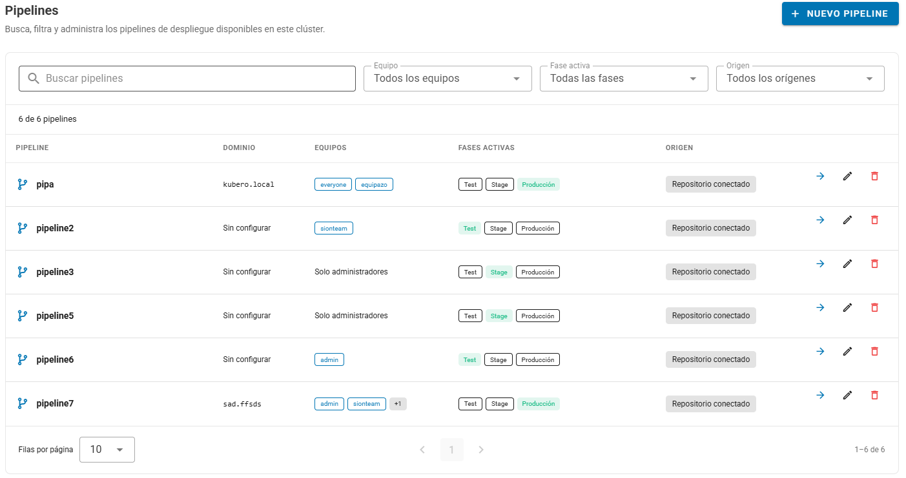

# Primeros Pasos

## Video tutorial

Sigue el tutorial en video como apoyo para comenzar con Kubero y desplegar tu proyecto.

<iframe
  src="https://www.youtube-nocookie.com/embed/omJ3Nt383GE"
  title="Tutorial de despliegue en Kubero para estudiantes"
  style="display: block; width: 100%; aspect-ratio: 16 / 9; border: 0;"
  loading="lazy"
  allow="accelerometer; autoplay; clipboard-write; encrypted-media; gyroscope; picture-in-picture; web-share"
  referrerpolicy="strict-origin-when-cross-origin"
  allowfullscreen
></iframe>

[Ver el tutorial en YouTube](https://youtu.be/omJ3Nt383GE).

Puedes encontrar el código del proyecto utilizado en el tutorial en el [repositorio kubero-demo-todo](https://github.com/BenjaminEspinozaFK/kubero-demo-todo).

## Acceder a Kubero

1. Abre tu navegador y ve a **`https://kubero.inf.uct.cl`**
2. Inicia sesión con las credenciales proporcionadas por el profesor.
3. Verás **Pipelines**, con los proyectos a los que tus equipos y permisos te dan acceso.
4. Usa la búsqueda y los filtros **Equipo**, **Fases activas** y **Origen** para encontrar el proyecto. Limpia los filtros si la lista parece vacía.

::: warning Antes de crear el proyecto
El profesor debe agregarte al equipo de tu grupo o trabajo individual. Si no aparece en el selector de acceso del pipeline, consulta al profesor. Revisa [Gestión de equipos y usuarios](profesores.md).
:::

## Continuar con el proyecto

Una vez que puedas ingresar y tengas tu equipo asignado, continúa con [Preparar tu repositorio en GitHub](despliegue.md#preparar-tu-repositorio-en-github). Allí configurarás la construcción y publicación de imágenes antes de crear el pipeline y desplegar las apps.
