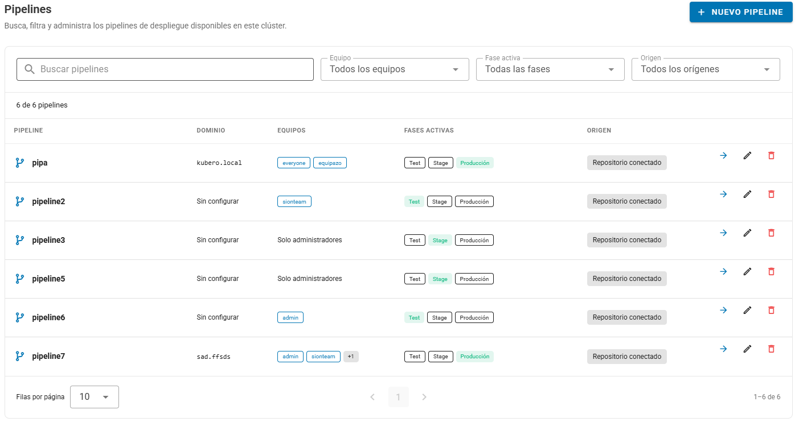

# Primeros Pasos

## Acceder a Kubero

1. Abre tu navegador y ve a **`https://kubero.inf.uct.cl`**
2. Inicia sesión con las credenciales proporcionadas por el profesor.
3. Verás **Pipelines**, con los proyectos a los que tus equipos y permisos te dan acceso.
4. Usa la búsqueda y los filtros **Equipo**, **Fases activas** y **Origen** para encontrar el proyecto. Limpia los filtros si la lista parece vacía.

::: warning Antes de crear el proyecto
El profesor debe agregarte al equipo de tu grupo o trabajo individual. Si no aparece en el selector de acceso del pipeline, consulta al profesor. Revisa [Gestión de equipos y usuarios](profesores.md).
:::

## Continuar con el proyecto

Una vez que puedas ingresar y tengas tu equipo asignado, continúa con [Preparar tu repositorio en GitHub](despliegue.md#preparar-tu-repositorio-en-github). Allí configurarás la construcción y publicación de imágenes antes de crear el pipeline y desplegar las apps.
