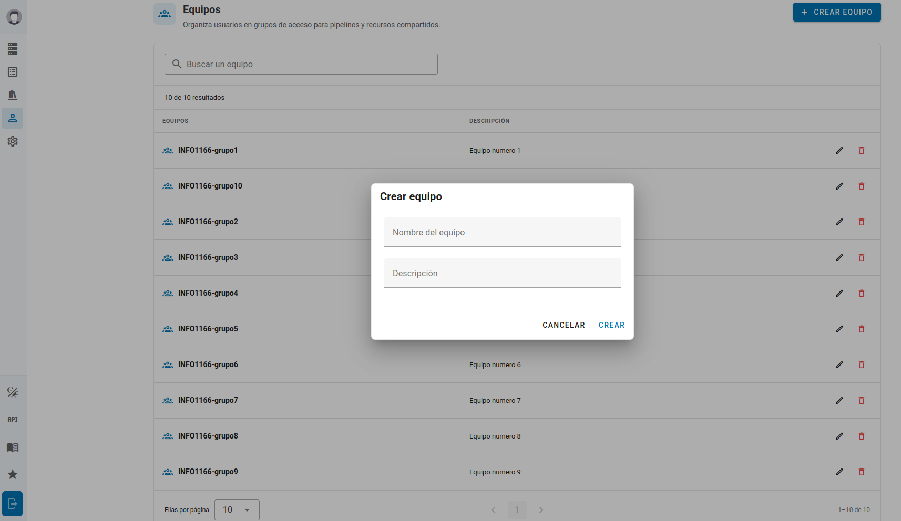
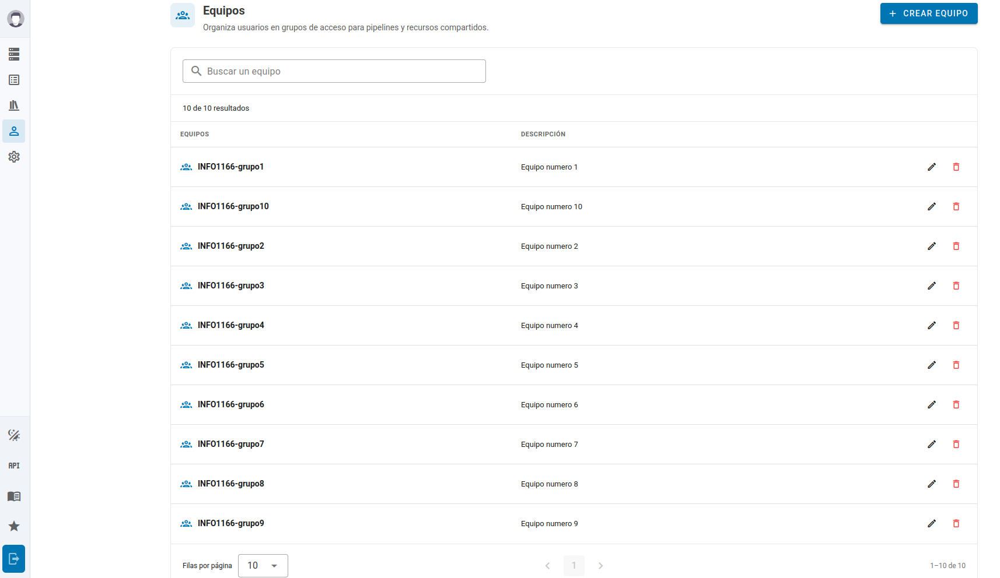
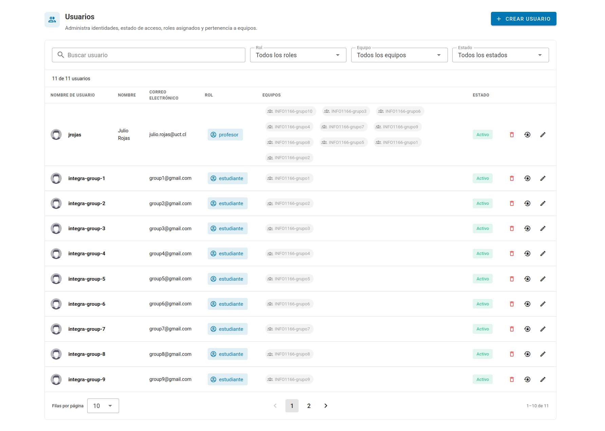
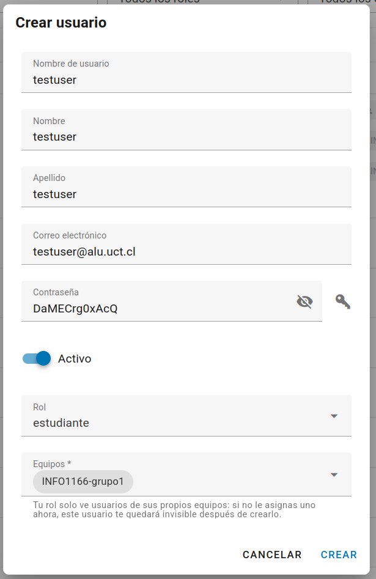
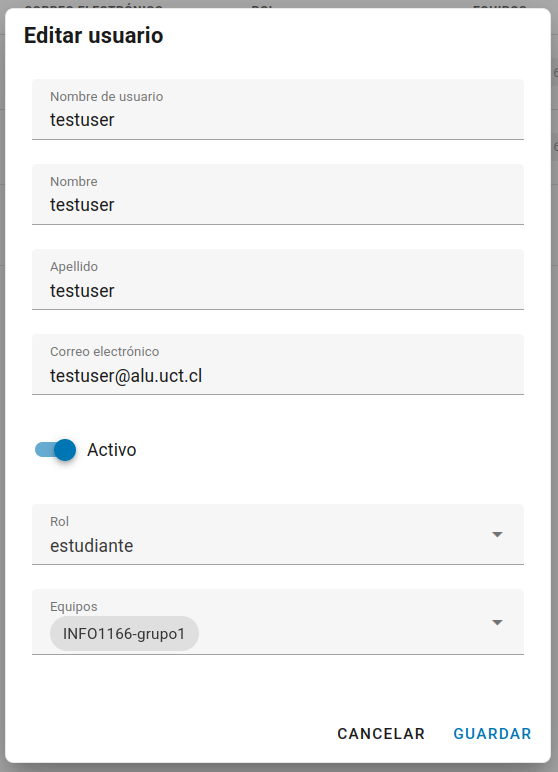
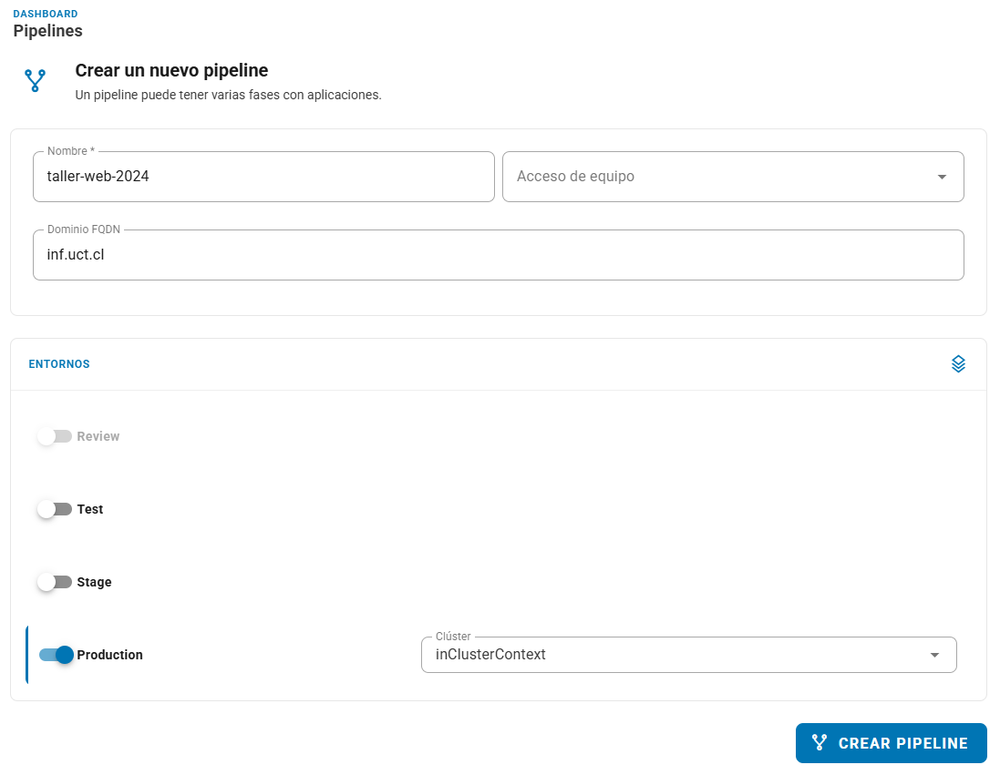
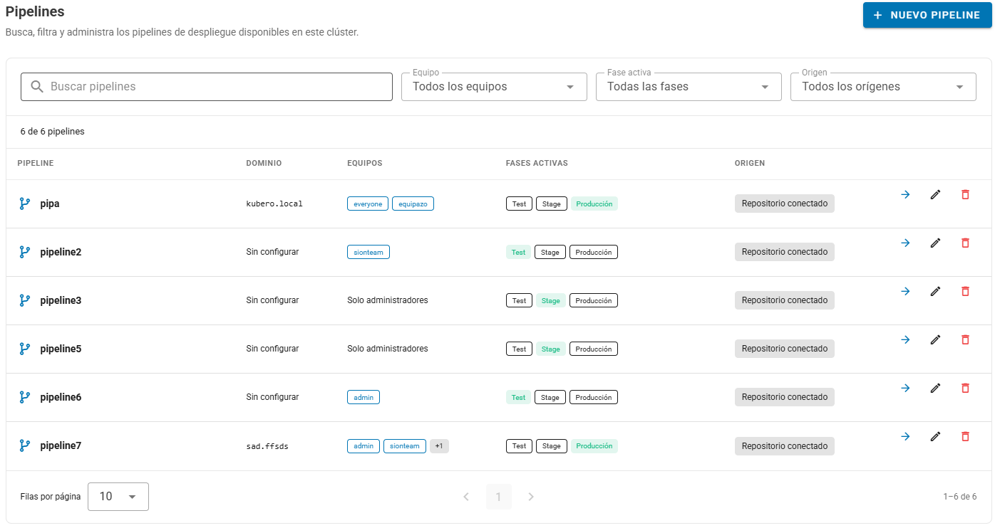
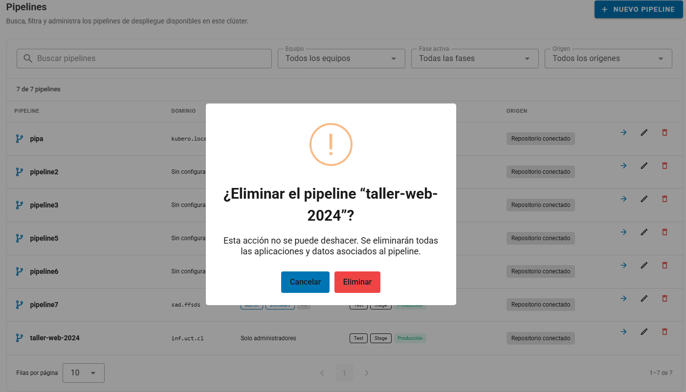

# Gestión de equipos y usuarios

Esta guía sigue el flujo del Profesor: primero crear los equipos del curso, luego crear cada usuario con su equipo asignado y finalmente revisar el acceso a los proyectos.

## Paso 1 — Crear los equipos del curso

Los equipos organizan el acceso a los pipelines. Una cuenta puede pertenecer a varios equipos y un pipeline puede permitir acceso a varios de ellos.

### Organización y nombres

Utiliza una de estas estructuras:

| Organización       | Estructura                       | Ejemplo                                     |
| ------------------ | -------------------------------- | ------------------------------------------- |
| Trabajo grupal     | `nombre del ramo - grupo_x`      | `Taller de Integración - grupo_1`           |
| Trabajo individual | `nombre del ramo - estudiante_x` | `Taller de Integración - estudiante_jperez` |

Mantén el mismo equipo en la membresía de las cuentas que lo requieran y en **"Equipos con acceso"** del pipeline. Evita cambios de nombre sin revisar los pipelines.

### Crear el equipo

1. Accede a [Kubero UCT](https://kubero.inf.uct.cl) con tu cuenta de **Profesor**.
2. Abre **Cuentas → Equipos** (**Accounts → Teams**).
3. Pulsa **Crear equipo** (**Create Team**).
   

4. Introduce el nombre y una descripción que identifique el ramo y el grupo.
5. Guarda el equipo.

Si creas el equipo con tu propia cuenta de Profesor, quedas agregado automáticamente como miembro — ya no es necesario editar tu cuenta para sumarte.

## Paso 2 — Crear usuarios y asignar su equipo

1. Accede a [Kubero UCT](https://kubero.inf.uct.cl) con tu cuenta de Profesor.
2. Abre **Cuentas → Usuarios** (**Accounts → Users**).
3. Pulsa **Crear usuario** (**Create User**).
   
4. Completa el formulario, asigna el rol **Estudiante** y selecciona el equipo que creaste en el paso anterior. La asignación del equipo se hace al crear el usuario.

| Campo             | Qué ingresar                                                                                                                            |
| ----------------- | --------------------------------------------------------------------------------------------------------------------------------------- |
| Nombre de usuario | Identificador de acceso, por ejemplo `jperez`.                                                                                          |
| Nombre y apellido | Datos del estudiante.                                                                                                                   |
| Correo            | Correo del estudiante.                                                                                                                  |
| Contraseña        | Contraseña inicial; el formulario permite mostrarla o generar una.                                                                      |
| Activo            | Habilita o deshabilita la cuenta.                                                                                                       |
| Rol               | La lista solo muestra roles que no superan el propio — como Profesor, se puede asignar Profesor o Estudiante, nunca Webmaster ni Admin. |
| Equipos           | Obligatorio. Uno o más equipos propios; si se deja vacío, el formulario no permite guardar.                                             |

5. Guarda y entrega las credenciales al estudiante para que acceda a [Kubero UCT](https://kubero.inf.uct.cl).
6. Repite la creación de cuentas para los demás integrantes, seleccionando el equipo correspondiente en cada una.

::: warning Importante
No elijas un permiso administrativo solo para que el estudiante vea un pipeline. Revisa el [acceso del equipo al pipeline](#paso-3-dar-acceso-al-pipeline).
:::

### Editar una cuenta y sus equipos

Usa el buscador y los filtros de **Rol**, **Equipo** y **Estado** para localizar la cuenta. Abre **Editar**, modifica los datos o la lista de equipos y guarda.

Las cuentas reservadas `admin` y `system` tienen **Editar** deshabilitado en la interfaz actual. Realiza el procedimiento con una cuenta docente editable; si tu cuenta está bloqueada o no puedes administrar usuarios, solicita al administrador de la plataforma que revise la configuración.

Tampoco es posible ver ni editar cuentas que no compartan un equipo con el Profesor — es el mismo acotamiento que aplica a Usuarios y Equipos.

## Paso 3 — Dar acceso al pipeline (opcional para el profesor) {#paso-3-dar-acceso-al-pipeline}

El profesor puede omitir este paso: los estudiantes pueden crear su pipeline y seleccionar por su cuenta el equipo del proyecto siguiendo la guía de [Crear pipeline, apps, base de datos y variables](despliegue.md). Para ello, el profesor debe haber creado previamente el equipo y las cuentas con ese equipo asignado.

Si prefieres configurar el acceso como profesor, sigue estos pasos:

1. Abre **Crear pipeline** o edita el pipeline del curso.
2. En **Acceso de equipo** (**Team Access**), selecciona el equipo creado.
3. Comprueba que tanto Estudiantes como Profesor pertenecen a ese equipo.
4. Guarda y verifica la visibilidad desde las cuentas del curso.

### Limitaciones y revisión

- Los equipos reservados `admin` y `everyone` no se pueden renombrar ni eliminar.
- El equipo reservado `admin` tiene acceso global en el código actual. No lo asignes para representar un grupo del curso.
- Un pipeline sin restricción de equipos puede tener un acceso más amplio; selecciona los equipos del curso explícitamente.
- Renombrar un equipo exige revisar el acceso de los pipelines que usan su nombre.
- Si falta un pipeline, limpia los filtros y comprueba membresías, nombres y permisos antes de concluir que fue eliminado.
- Un Profesor solo ve los equipos a los que pertenece. Si falta un equipo que debería estar ahí, revisa que tu propia cuenta sea miembro.
- Al asignar equipos a un usuario nuevo, es obligatorio dejarle al menos uno propio — el sistema bloquea guardar si se deja vacío, para que ningún usuario quede sin equipo y, por lo tanto, invisible para el Profesor.

## Paso 4 — El estudiante trabaja de forma autónoma

Con la cuenta activa, el equipo asignado y los permisos correspondientes, el Estudiante puede seguir las guías de [Primeros pasos](primeros-pasos.md), [Crear pipeline, apps, base de datos y variables](despliegue.md) y [Autodeploy](autodeploy.md).

El profesor **no necesita intervenir** en el proceso de despliegue del estudiante — Kubero está diseñado para que cada usuario gestione sus propios proyectos de forma independiente.

---

## Paso 5 — Monitorear el trabajo de los estudiantes

1. Abre **Pipelines** y revisa los filtros activos.
2. Selecciona el pipeline que quieras revisar.
3. Abre sus apps para revisar resumen, métricas, registros y eventos.
4. Ante un pipeline ausente, verifica la membresía de tu propia cuenta y la selección de equipos del pipeline.

Ser Profesor no implica por sí solo ver todos los pipelines de la instalación. El acceso depende de los equipos y permisos de la cuenta. Consulta [Routing y monitoreo](despliegue.md#monitorear-tu-despliegue) para diagnosticar aplicaciones.

> Esto es útil para revisar el estado de los proyectos durante una evaluación o para ayudar a un estudiante a diagnosticar un error sin necesidad de que él comparta su pantalla.

## Paso 6 — Limpiar al finalizar el semestre

Antes de eliminar recursos, acuerda el cierre del curso y conserva los datos que deban mantenerse.

**Pipeline y aplicaciones:** utiliza la acción de eliminación correspondiente y revisa la confirmación del pipeline seleccionado y el alcance indicado. No elimines un pipeline compartido con otro curso. Verifica los respaldos y la retención de [Volúmenes](extras/volumenes.md).

**Cuenta de estudiante:** abre **Cuentas → Usuarios**, localiza la cuenta y elige desactivarla o eliminarla según el procedimiento del curso. Desactivar la cuenta impide su autenticación, pero no sustituye la limpieza de sus aplicaciones.

**Equipos:** revisa membresías y pipelines asociados antes de retirar un equipo. Su eliminación no debe usarse como sustituto de borrar recursos; revisa las [limitaciones y membresías](#limitaciones-y-revision).
