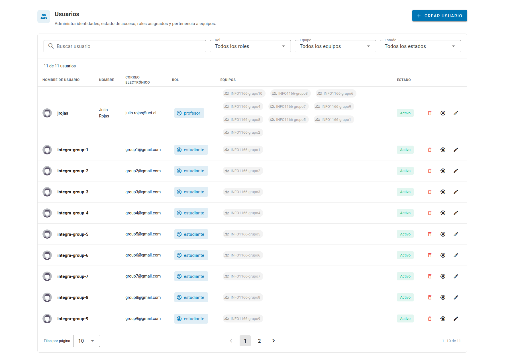
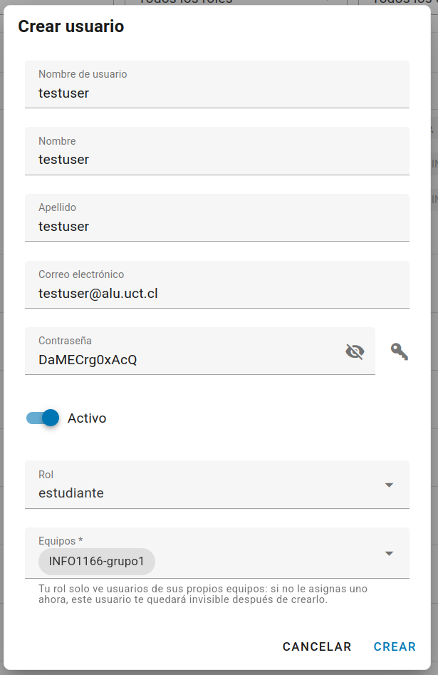
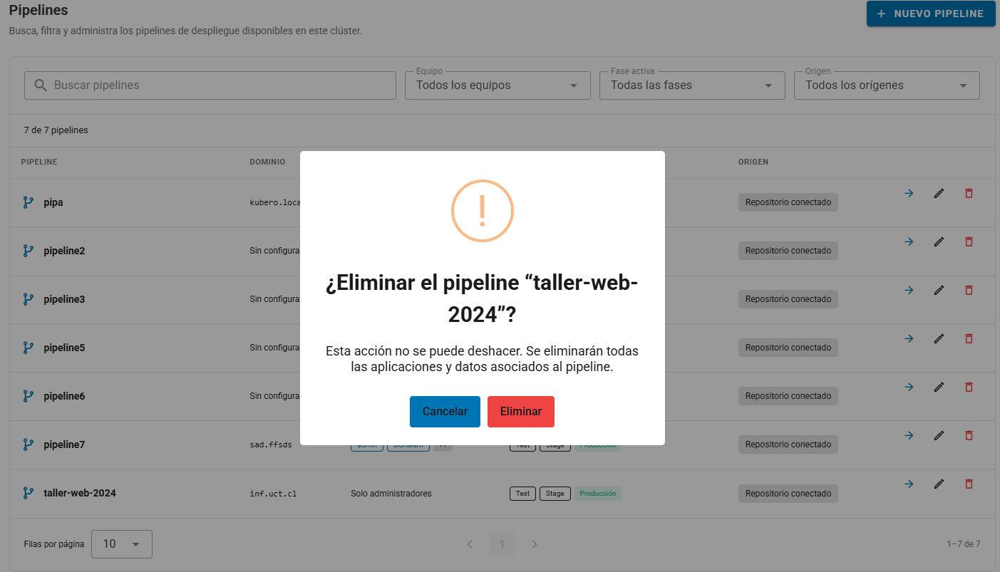

# Gestión de Usuarios (Solo Profesores)

Esta guía describe cómo el **Profesor** incorpora estudiantes, asigna equipos y revisa sus proyectos.

## Paso 1 — Inscribir estudiantes en la plataforma

1. Accede a [Kubero UCT](https://kubero.inf.uct.cl) con tu cuenta de Profesor.
2. Abre **Cuentas → Usuarios** (**Accounts → Users**).
3. Pulsa **Crear usuario** (**Create User**).
   
4. Completa el formulario y selecciona los equipos del estudiante.

| Campo             | Qué ingresar                                                                                                                            |
| ----------------- | --------------------------------------------------------------------------------------------------------------------------------------- |
| Nombre de usuario | Identificador de acceso, por ejemplo `jperez`.                                                                                          |
| Nombre y apellido | Datos del estudiante.                                                                                                                   |
| Correo            | Correo del estudiante.                                                                                                                  |
| Contraseña        | Contraseña inicial; el formulario permite mostrarla o generar una.                                                                      |
| Activo            | Habilita o deshabilita la cuenta.                                                                                                       |
| Rol               | La lista solo muestra roles que no superan el propio — como Profesor, se puede asignar Profesor o Estudiante, nunca Webmaster ni Admin. |
| Equipos           | Obligatorio. Uno o más equipos propios; si se deja vacío, el formulario no permite guardar.                                             |

5. Guarda y entrega las credenciales al estudiante para que acceda a [Kubero UCT](https://kubero.inf.uct.cl).

::: warning Importante
No elijas un permiso administrativo solo para que el estudiante vea un pipeline. Consulta [Gestión de equipos](gestion-de-equipos.md).
:::

### Editar una cuenta y sus equipos

Usa el buscador y los filtros de **Rol**, **Equipo** y **Estado** para localizar la cuenta. Abre **Editar**, modifica los datos o la lista de equipos y guarda.

Al crear un equipo, el Profesor queda agregado automáticamente como miembro — ya no es necesario editar la propia cuenta para sumarse.

Las cuentas reservadas `admin` y `system` tienen **Editar** deshabilitado en la interfaz actual. Realiza el procedimiento con una cuenta docente editable; si tu cuenta está bloqueada o no puedes administrar usuarios, solicita al administrador de la plataforma que revise la configuración.

Tampoco es posible ver ni editar cuentas que no compartan un equipo con el Profesor — es el mismo acotamiento que aplica a Usuarios y Equipos.

## Paso 2 — El estudiante trabaja de forma autónoma

Con la cuenta activa, el equipo asignado y los permisos correspondientes, el Estudiante puede seguir las guías de [Primeros pasos](primeros-pasos.md), [Crear pipeline y app](despliegue.md) y [Autodeploy](autodeploy.md).

El profesor **no necesita intervenir** en el proceso de despliegue del estudiante — Kubero está diseñado para que cada usuario gestione sus propios proyectos de forma independiente.

---

## Paso 3 — Monitorear el trabajo de los estudiantes

1. Abre **Pipelines** y revisa los filtros activos.
2. Selecciona el pipeline que quieras
3. Abre sus apps para revisar resumen, métricas, registros y eventos.
4. Ante un pipeline ausente, verifica la membresía de tu propia cuenta y la selección de equipos del pipeline.

Ser Profesor no implica por sí solo ver todos los pipelines de la instalación. El acceso depende de los equipos y permisos de la cuenta. Consulta [Routing y monitoreo](routing-y-monitoreo.md) para diagnosticar aplicaciones.

> Esto es útil para revisar el estado de los proyectos durante una evaluación o para ayudar a un estudiante a diagnosticar un error sin necesidad de que él comparta su pantalla.

## Paso 4 — Limpiar al finalizar el semestre

Antes de eliminar recursos, acuerda el cierre del curso y conserva los datos que deban mantenerse.

**Pipeline y aplicaciones:** utiliza la acción de eliminación correspondiente y revisa la confirmación del pipeline seleccionado y el alcance indicado. No elimines un pipeline compartido con otro curso. Verifica los respaldos y la retención de [Volúmenes](extras/volumenes.md).

**Cuenta de estudiante:** abre **Cuentas → Usuarios**, localiza la cuenta y elige desactivarla o eliminarla según el procedimiento del curso. Desactivar la cuenta impide su autenticación, pero no sustituye la limpieza de sus aplicaciones.

**Equipos:** revisa membresías y pipelines asociados antes de retirar un equipo. Su eliminación no debe usarse como sustituto de borrar recursos; consulta [Gestión de equipos](gestion-de-equipos.md).
