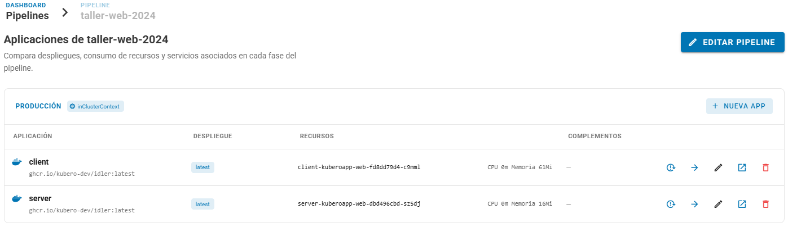
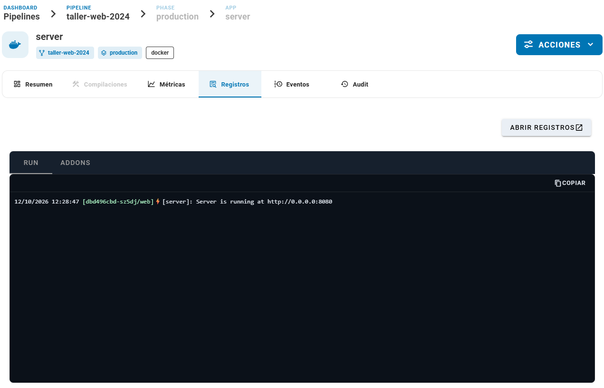

# Routing y Monitoreo

## Routing entre servicios (Frontend + Backend)

En aplicaciones donde el frontend (React, Vue, etc.) y el backend están separados, el frontend necesita saber cómo llegar al backend para hacer llamadas a la API.

### La solución en Kubero UCT: dominios separados

La forma correcta en esta plataforma es darle a cada servicio su **propio dominio** en Kubero. Así el frontend llama directamente al dominio público del backend — sin configuraciones especiales de nginx ni acceso al cluster.

**Ejemplo:**
| App | Dominio en Kubero |
|---|---|
| Frontend | `mi-proyecto.inf.uct.cl` |
| Backend | `api-mi-proyecto.inf.uct.cl` |

El frontend hace sus llamadas API directamente a `https://api-mi-proyecto.inf.uct.cl` desde el código.

### Paso 1 — Crear dos apps en Kubero con dominios distintos

Al crear las apps dentro de tu pipeline, asigna un dominio diferente a cada una:

- App `frontend` → Domain: `mi-proyecto.inf.uct.cl`
- App `backend` → Domain: `api-mi-proyecto.inf.uct.cl`

Ambas apps quedan accesibles con HTTPS automático desde sus respectivos dominios.

### Paso 2 — Configurar la URL del backend en el frontend

Para un frontend construido con Vite:

~~~env
VITE_API_URL=https://api-mi-proyecto.inf.uct.cl
~~~

Las variables `VITE_*` se incorporan durante la **construcción** del frontend. Si tu imagen sirve archivos estáticos, agregarlas únicamente al contenedor en ejecución no cambia esos archivos: incorpora el valor al build y publica una nueva imagen, o usa la configuración de runtime que implemente tu proyecto. Consulta [Variables de entorno en Vite](https://vite.dev/guide/env-and-mode.html).

~~~javascript
const API_URL = import.meta.env.VITE_API_URL

const response = await fetch(API_URL + '/users/login', {
  method: 'POST',
  headers: { 'Content-Type': 'application/json' },
  body: JSON.stringify({ email, password })
})
~~~

> **¿Por qué no usar nginx como proxy (`/api/`)?**
> Hacer que `/api/` redirija al backend en el mismo dominio requiere modificar el Ingress de Kubernetes, lo cual no se puede hacer desde la UI de Kubero. La solución de dominios separados funciona completamente desde la interfaz sin tocar el cluster.

## Monitorear tu Despliegue

### Estado de la App

Revisa pod, CPU y memoria cuando estén disponibles. **Métricas no disponibles** puede indicar que aún no hay mediciones; verifica **Resumen** y **Eventos** antes de concluir que el servicio está detenido.
### Ver Logs en Tiempo Real

1. Abre la aplicación desde la tabla del pipeline.
2. Selecciona **Registros**.
3. Usa **Abrir registros** si aparece ese botón.
4. Elige el origen disponible: **Run** para la app o **Addons** para sus complementos.

Los registros ayudan a diagnosticar inicio, conexión y fallos de la aplicación.

### Errores comunes y cómo resolverlos

| Error en logs | Causa | Solución |
|---|---|---|
| `Name does not resolve` | El hostname de la base de datos está mal escrito | Verifica que `POSTGRES_HOST` sea `[tu-app]-postgres` |
| `password authentication failed` | Las credenciales de la DB no coinciden | Revisa que `POSTGRES_USER` y `POSTGRES_PASSWORD` sean los mismos que configuraste en el addon |
| `connection refused` | Puerto equivocado o servicio no está corriendo | Verifica el puerto (postgres: `5432`, no `80`) |
| `ImagePullBackOff` | Kubero no puede descargar la imagen | Verifica que la imagen en ghcr.io sea pública |
| `CrashLoopBackOff` | La app inicia y falla repetidamente | Lee los logs para ver el error específico |

---

## Limitaciones Conocidas

Estas son limitaciones de la configuración actual de Kubero en la UCT que es importante conocer:

| Limitación | Descripción |
|---|---|
| **No hay build interno** | Kubero en la UCT no construye imágenes internamente. Siempre debes usar la estrategia "Container Image" con imágenes ya construidas en GitHub Actions y subidas a ghcr.io |
| **Dominio opcional para servicios internos** | Si no quieres que una app sea pública, deja el campo Domain vacío — no se creará ingress y el servicio solo estará disponible dentro del cluster. Esto es útil para bases de datos con imagen custom u otros servicios internos (ver "App Interna sin Exposición Pública" en Base de Datos) |
| **Health checks en PostgreSQL** | Kubero activa health checks HTTP para todas las apps por defecto, lo que falla en servicios que no hablan HTTP (como PostgreSQL). Si el addon de postgres crashea, desactiva los health checks en la sección **HEALTH CHECKS** de la app |
| **Routing multi-servicio** | Si el frontend y el backend comparten el mismo dominio, el nginx del frontend debe estar configurado para hacer `proxy_pass` al servicio interno del backend. Esto debe hacerse en el `nginx.conf` de la imagen del frontend |
| **Addons fijos** | Los addons predefinidos (PostgreSQL, Redis, etc.) usan imágenes estándar. Si necesitas una imagen custom (ej: Apache AGE, PostGIS), debes crear una **app interna sin dominio público** en vez de usar el addon — ver sección "App Interna sin Exposición Pública" en Base de Datos |